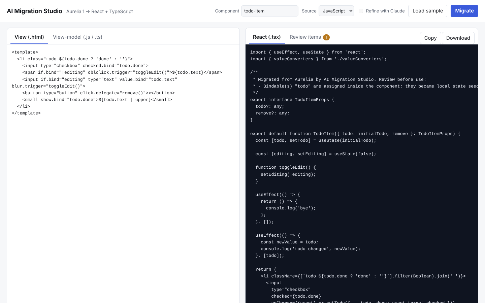
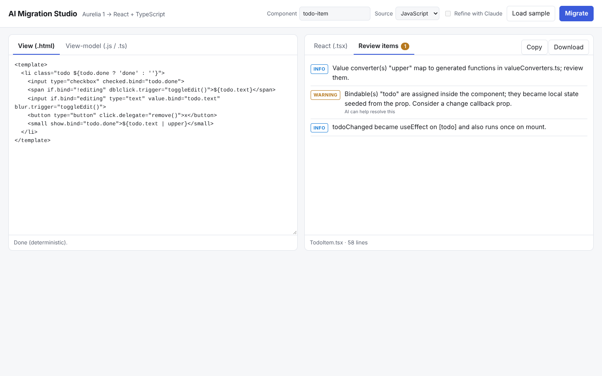

# AI Migration Studio

Migrates **Aurelia 1** apps (old JavaScript or TypeScript) to **React function components with TypeScript hooks**.

It works in two layers:

1. **Deterministic engine.** Parses each Aurelia view (`.html`) with parse5 and each view-model (`.js`/`.ts`) with the TypeScript compiler API, then generates a React `.tsx` component by rules. Everything it cannot convert with confidence is reported as a review item instead of guessed.
2. **Optional Claude refinement.** Only the items flagged "needs review" are sent to Claude. The reply is accepted only if it exports the expected component and parses; otherwise the deterministic draft is kept. Source code is sent as data inside delimiters with a system prompt that tells the model to ignore any instructions inside it.




## Quick start

```bash
npm install
npm test

# CLI
npx tsx src/cli.ts migrate ./my-aurelia-app/src --out ./migrated-out
npx tsx src/cli.ts migrate ./my-aurelia-app/src --out ./migrated-out --ai   # needs ANTHROPIC_API_KEY

# Web studio (http://localhost:4100)
npx tsx src/cli.ts studio
```

Output for a project: one `.tsx` per view/view-model pair (mirroring folders), `services.tsx` (replacement for Aurelia DI), `valueConverters.ts`, and `MIGRATION_REPORT.md`.

## What converts automatically

| Aurelia | React output |
|---|---|
| `${expr}` in text and attributes | `{expr}` / template literals |
| `if.bind`, `show.bind` | `cond && (...)`, `style={{ display: 'none' }}` |
| `repeat.for="x of xs"`, `of 3` | `xs.map((x, $index) => ...)`, `$first/$last/$even/$odd` supported |
| `value.bind`, `checked.bind`, radio `model.bind` | controlled inputs with immutable `setX({ ...x, a: v })` updates |
| `click.delegate/trigger`, `submit.delegate` | `onClick`, `onSubmit` (with `preventDefault`, matching Aurelia) |
| `class.bind`, `x.class="cond"`, static `style` | `className` array join, style object |
| `ref="x"` | `useRef`, `this.x` becomes `x.current` |
| `<require from>` + custom elements | default imports of migrated components, CSS side-effect imports |
| `<slot>` | `children` |
| `@bindable` | typed props (with defaults) |
| class fields | `useState` if assigned anywhere, otherwise `const` |
| `this.x = v`, `+=`, `++`, `push/unshift/splice(i,n)` | `setX(...)` immutable updates |
| getters | derived constants |
| `attached`/`detached`, `bind`/`created`/`activate` | `useEffect` with cleanup (async bodies wrapped) |
| `xChanged(newValue)` | `useEffect` on `[x]` |
| `@inject`, `static inject`, constructor DI | `useService(token)` from generated `services.tsx` |
| value converters (`| name:arg`) | generated functions in `valueConverters.ts` |

## What is flagged for review (not guessed)

Binding behaviors, `<compose>`, `<router-view>` and router lifecycle hooks, `else`, two-way bindings into custom elements (a change callback prop is generated), in-place mutations it cannot rewrite (`sort`, `reverse`, index assignment), `$parent`/`$this`, unresolved identifiers, constructor logic, setters, bindables assigned inside the component, `.fromView` converters, and non-component files (services, models, `main`). Each shows up in the file header, the studio's Review tab, and `MIGRATION_REPORT.md`.

## Known limitations

- Aurelia 1 only. Aurelia 2 is not supported.
- Whitespace between block elements on separate lines is dropped (JSX convention); inline spacing is preserved.
- `key={$index}` is generated for `repeat.for`; replace it with a stable id.
- Aurelia prevents default on `click`/`submit` handlers unless they return `true`; this is reproduced for `<a>`, submit buttons and forms, but not the "return true" opt-out.
- `xChanged` effects also run once on mount, and the old value is not available.
- Generated code is a starting point. Always review the report and run your own tests. The repo's tests compile the generated sample under strict TypeScript, but they cannot prove behavior equivalence for your app.

## AI refinement

`ANTHROPIC_API_KEY` enables it (`AMS_MODEL` overrides the default `claude-sonnet-5-5`). Without a key, `--ai` exits with an error and the studio disables the checkbox; nothing is faked. Refined output is re-validated (must export the same component and parse) and marked in the report.

## Project layout

```
src/core/      vm.ts (view-model analysis), template.ts + expr.ts (view conversion),
               rewrite.ts (this.* -> hooks), generate.ts (component), project.ts, ai.ts
src/cli.ts     ams CLI
src/studio/    Express API serving public/index.html
test/          unit, project, compile (strict tsc over generated output), AI, studio tests
```

## CI

`.github/workflows/ci.yml` runs typecheck, tests (including the strict-compile check) and build on every push and pull request.
